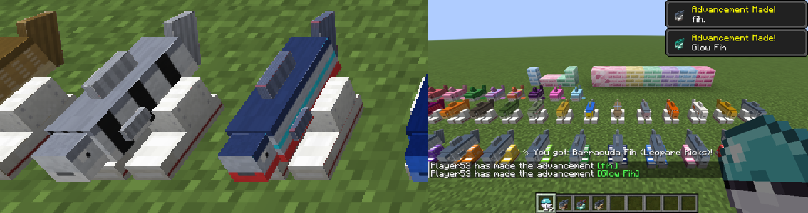
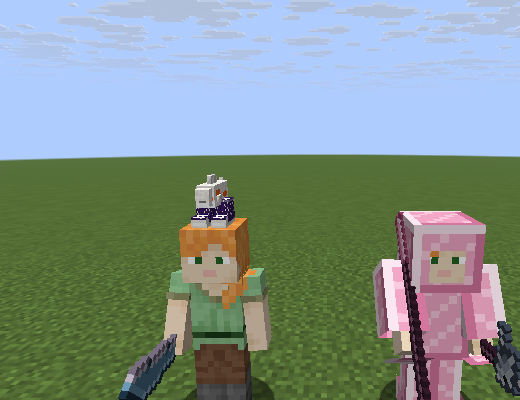
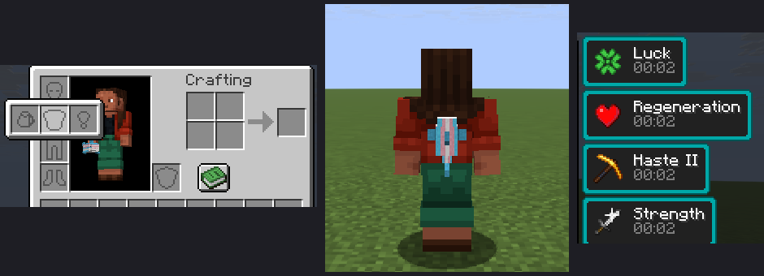
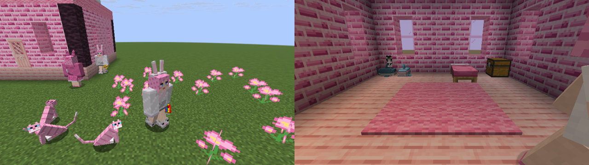
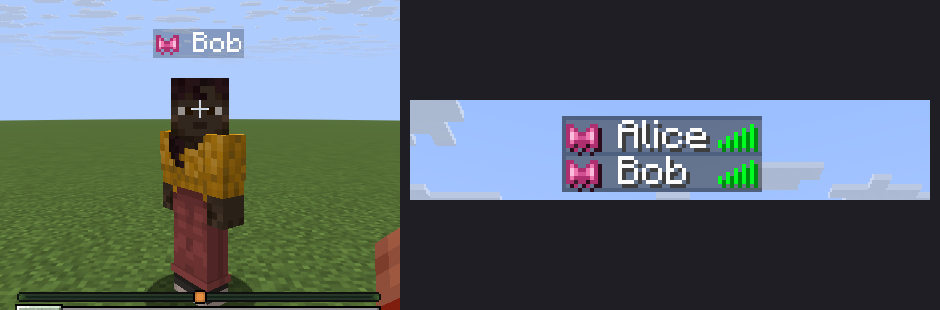
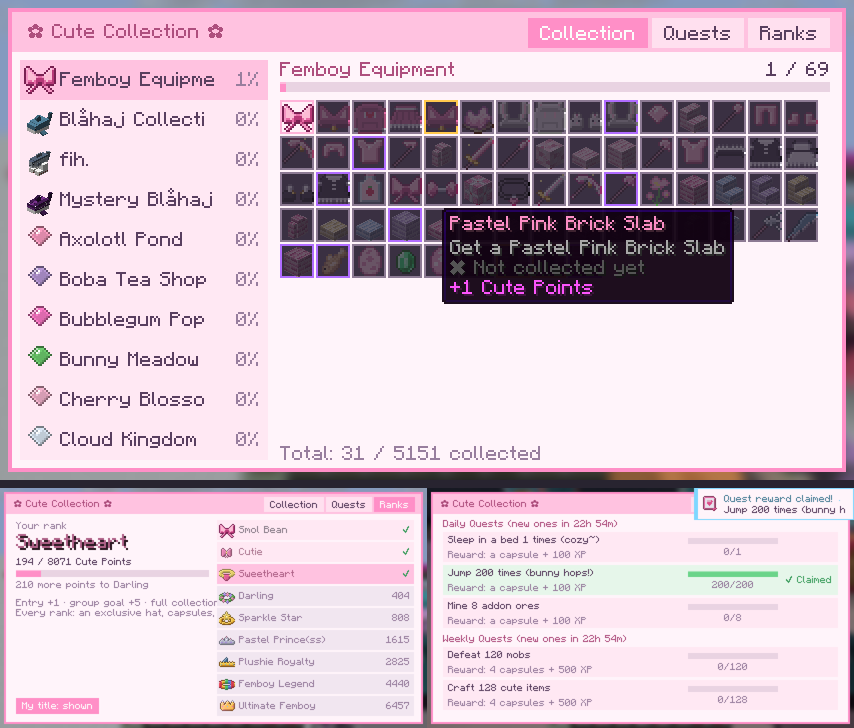
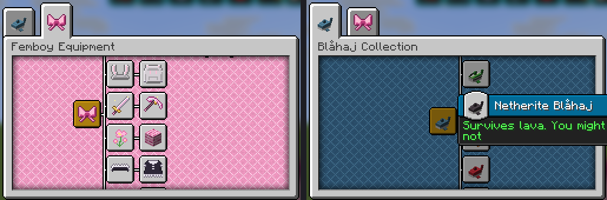
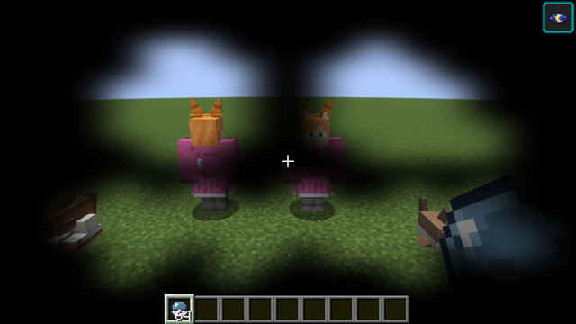
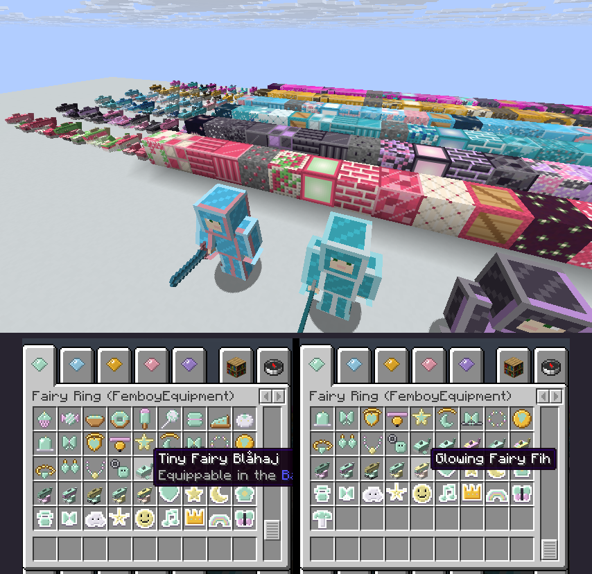

# FemboyEquipment 🎀

A cute little [Fabric](https://fabricmc.net/) mod for **Minecraft 1.21.11**.

## Download

Grab the latest jar from the [Releases page](../../releases/latest) and drop it into your `mods`
folder together with [Fabric API](https://modrinth.com/mod/fabric-api).

## Features

### Cat outfit 🐱

| Piece | Slot | Effect while worn |
|---|---|---|
| **Cat Ears** | Head | Night Vision |
| **Femboy Hoodie** | Chest | Regeneration I |
| **Pleated Skirt** | Legs | Speed I |
| **Thigh Highs** ✨ | Feet | Absolutely broken: Speed III, Haste III, Strength III, Resistance III, Jump Boost II, Regeneration II, Fire Resistance, Water Breathing, Dolphin's Grace, Saturation, no fall damage, slow falling while sneaking mid-air. Unbreakable, fire-proof, 8 armor, 6 toughness. |

Wear all four for a set bonus: **Luck II** + **Hero of the Village** (cheap villager trades~).

### Maid outfit 🖤

| Piece | Slot | Effect while worn |
|---|---|---|
| **Maid Headband** | Head | Haste I |
| **Maid Dress** | Chest | Resistance I |
| **Maid Apron** | Legs | Fire Resistance |
| **Mary Janes** | Feet | Speed I |

Full set bonus: **Haste II** + **Strength I**.

### Bunny outfit 🐰

| Piece | Slot | Effect while worn |
|---|---|---|
| **Bunny Ears** | Head | Jump Boost I |
| **Bunny Hoodie** | Chest | Regeneration I |
| **Fluffy Slippers** | Feet | Jump Boost II, no fall damage |

Full set bonus (all three): **Speed II** + **Jump Boost III**.

### 3D accessories & dyeing

- Cat Ears and Bunny Ears render as real 3D ears, and come with a swishing cat tail / fluffy bunny tail
- The Pleated Skirt and Maid Apron render as flared 3D skirts
- **Every outfit piece is dyeable** like leather armor. Craft it with any dye to recolor it (ears and tails included).

### Blåhaj 🦈

**1000** squishy shark plushies! 130 hand-made ones with recipes, plus 870 capsule-only ones
(29 colors × 30 patterns: striped, polka dot, galaxy, tie-dye, holographic, cursed…). Place them on the floor (they look at you), **wear one as a hat**, or **hug one**
(hold it in either hand or wear it) for Regeneration. They have their own creative tab.

- **Classic Blåhaj**: craft with `" C "` · `"CBC"` · `"WWB"` (Cyan Wool, Light Blue Wool, White Wool)
- **Pride flags**: craft a classic Blåhaj with the flag's dyes (shapeless):

| Variant | Extra ingredients |
|---|---|
| Trans | Light Blue, Pink, White dye |
| Pride | Red, Orange, Yellow, Green, Blue, Purple dye |
| Bi | Magenta, Purple, Blue dye |
| Pan | Pink, Yellow, Light Blue dye |
| Lesbian | Orange, White, Magenta dye |
| Gay | Cyan, White, Blue dye |
| Nonbinary | Yellow, White, Purple, Black dye |
| Ace | Black, Gray, White, Purple dye |
| Aro | Green, Lime, White, Gray, Black dye |
| Genderfluid | Pink, White, Purple, Black, Blue dye |
| Agender | Black, Light Gray, White, Lime dye |
| Intersex | Yellow, Purple dye |
| Demiboy | Gray, Light Blue, White dye |
| Demigirl | Gray, Pink, White dye |
| Femboy | Pink, White, Light Blue, Blue dye |

- **Solid colors**: Classic Blåhaj + one dye: Pink, Red, Orange, Yellow, Mint (lime), Purple, Goth (black), Ghost (white), Chocolate (brown), Magenta
- **100 more** (each is a classic Blåhaj + something themed, see the recipe book):
  - **More flags**: Progress Pride, Transfem, Transmasc, Genderqueer, Bigender, Polysexual, Omnisexual, Aroace,
    Demisexual, Demiromantic, Graysexual, Abrosexual, Sapphic, Achillean, Androgyne, Neutrois, Genderflux, Maverique,
    Polyamorous, Pangender (+ that flag's dyes)
  - **Food**: Strawberry, Blueberry, Watermelon, Pumpkin Spice, Apple, Cookie, Cake, Honey, Glow Berry, Mushroom,
    Cotton Candy, Mocha, Mint Chip, Bubblegum
  - **Minerals**: Emerald, Amethyst, Copper, Iron, Redstone, Lapis, Quartz, Prismarine, Resin, Echo
  - **Mobs**: Creeper, Enderman, Slime, Magma, Blaze, Wither, Axolotl, Frog, Bee, Warden, Sniffer, Squid, Phantom,
    Ghast, Shulker, Turtle, Armadillo, Breeze, Dragon, Panda
  - **Nature**: Sakura, Sunflower, Lilac, Rose, Cornflower, Lily, Tulip, Moss, Cactus, Snow, Ice, Coral
  - **Sky**: Sunset, Sunrise, Midnight, Aurora, Galaxy, Ocean, Storm, Star ✨, Sun ☀️, Moon
  - **Aesthetics**: Vaporwave, Pastel Goth, Emo, Scene, Y2K, Cottagecore
  - **Elements**: Fire 🔥, Water, Earth, Lightning, Void
  - **Holidays**: Christmas, Halloween, Valentine
  - Star, Sun, Fire and Blaze Blåhaj glow; Fire, Blaze and Magma Blåhaj are fire-proof
- **Fancy**: Classic Blåhaj + Gold Ingot (Golden), Diamond (Diamond), Netherite Scrap (Netherite, fire-proof), Glow Ink Sac (**Glow Blåhaj** glows in the dark!)

### fih. 🐟👟

**1000 fih**: a fish standing in a pair of high-top sneakers. 40 fish (Silver, Koi, Clownfish, Pufferfish, Betta,
Lionfish, Trans, Pride, Glow…) × 25 kicks (White, Black, Rainbow, Trans, Checkered, Galaxy, Leopard, Gold, Diamond…).
The one true **fih.** is the Silver Fih in White Kicks. Place them, wear them as hats, and get them from **Fih Capsules**
(Cod + Leather + Emerald, or from Femboy Traders). They have their own creative tab and advancement tab.

### Gacha capsules 🎰

Right-click a **Blåhaj Capsule** (Light Blue Wool + White Wool + Emerald) or **Fih Capsule** (Cod + Leather + Emerald)
to get a random plushie. This is the only way to get the 870 capsule-only Blåhaj.

### Gear ⚔️

- **Rose Quartz**: craft from Amethyst Shard + Quartz + Pink Dye (→ 2). Diamond-tier armor (full set: Resistance + Haste),
  sword, pickaxe, axe, shovel, hoe and a **spear**, plus Rose Quartz Block and Bricks
- **Sparkly Axe, Shovel & Hoe**: a diamond tool + 2 Pink Ribbons
- **Fih Slapper** (Cod, Cod, Stick): slaps things away with a flop sound
- **Blåhaj Bat** (Blåhaj, Blåhaj, Stick): sends mobs flying. Bonk
- **Pastel bricks** in pink, blue, lavender, mint and yellow, and **stairs, slabs and walls** for every pastel and
  Rose Quartz brick

### Accessory slots (Trinkets) 🎒

Accessory slots come **built in**: the mod bundles [Trinkets Canary](https://modrinth.com/mod/trinkets-canary)
(MIT, by Ryhon, Emi & C4), so you don't need to install anything extra. Hover an armor slot in your inventory to open them:

| Slot | Wear | Bonus |
|---|---|---|
| Head → Hat | Hair Clip, Pink Ribbon | Hair Clip: Luck |
| Chest → Necklace | Choker | Strength |
| Chest → Back | **Any Blåhaj** (it rides on your back!) | Regeneration |
| Feet → Socks *(new slot)* | Programming Socks | Haste II |

Accessories also still work held in your offhand. If you install a newer Trinkets fork yourself, Fabric uses the newer one.

### Cute houses, traders & kitties 🏠

- **Cute houses** generate in plains, meadows, flower forests and cherry groves (`/locate structure femboyequipment:cute_house`).
  Pastel pink brick walls, a cherry wood floor, a bed, Blåhajs and a loot chest full of goodies.
- **Femboy Traders** live inside, dressed in a random outfit (cat, maid or bunny) and hugging a Blåhaj.
  Right-click to trade emeralds for ribbons, strawberry milk, outfit pieces, Blåhajs… and, very rarely, *the thigh highs*.
  There's also a Femboy Trader spawn egg.
- **Pink cats**: a new cat variant. Every cute house comes with one, and village cats can be pink too.
  Tame one with fish: while your pink kitty is within 8 blocks it purrs you Regeneration + Luck.
  There's also a **Pink Cat Spawn Egg** that always hatches a pink kitty.
- **Pastel Bloom**: a new pink flower in meadows, plains, flower forests and cherry groves. Craft it into 2 pink dye.
- **Chest loot**: village houses, dungeons, mineshafts, mansions and shipwreck supply chests sometimes hold ribbons,
  strawberry milk, accessories, Blåhajs and the odd outfit piece.

### Emblems 🎀

Like Lunar Client's emblem: **players who both have FemboyEquipment see a little pink bow next to each other's
names**, above their heads, in the tab list and **in chat**. It works on **any server**, even vanilla servers without the mod
(you just can't use the mod's items there).

**Badges** 🏅: some players get badge emblems instead of the bow: 👑 owner, developer, moderator, contributor, artist,
translator, media, bug hunter, tester, supporter, partner, OG and friend (up to 3 shown, hover a name in chat to see
them all). The list lives in [FemboyEquipment-Badge-Users](https://github.com/NeonWardonmc/FemboyEquipment-Badge-Users)
(`badges.txt`, one line per player: `uuid | badge | backup-username`). The mod downloads it on startup and every 30
minutes and caches it. The backup username is used on offline-mode/"cracked" servers.

**Toggle it** with the client command `/emblem`:

| Command | What it does |
|---|---|
| `/emblem` | Show your current settings and your badges |
| `/emblem share off` / `on` | Hide your emblem from others (you look like a normal player) / share it again |
| `/emblem display off` / `on` | Stop / start showing other people's emblems |

Settings are saved in `config/femboyequipment-client.json`.

How it works: your client sends the server which skin layers you show (hat, jacket, sleeves…) as a byte, and the
server shares it with everyone. Vanilla only uses 7 of those 8 bits, so the mod sets the spare one as a
"has FemboyEquipment" flag. No server-side support is needed (the only download is the public badge list). The tab list remembers players once you've seen them nearby.

### Cute Collection 📖 (custom advancement system)

FemboyEquipment's and every addon's advancements live in their own **Cute Collection** screen instead of the vanilla
one. Open it with **K**, the **Collection Book** (book + pink dye), the **♥ button** in your inventory, or `/collection`.

- **Collection**: a page per tab/addon with progress bars and every collectible in a grid (missing ones are dimmed,
  group goals have a gold frame, full-collection challenges a purple one)
- **Cute Points & 9 ranks**: Smol Bean → Cutie → Sweetheart → Darling → Sparkle Star → Pastel Prince(ss) →
  Plushie Royalty → Femboy Legend → Ultimate Femboy. Every rank-up gives a **rank-exclusive hat** (bow, halos, flower
  crown, tiara, Blåhaj crown, rainbow halo, Ultimate crown), capsules and XP levels, and your rank shows as a
  **title** before your name in chat, the tab list and your name tag (toggle it in the Ranks tab)
- **Rewards**: finishing a group gives a capsule + a bundle of that addon's materials; finishing a whole page gives
  6 capsules + a big bundle
- **Quests**: 3 daily + 2 weekly quests (they reset at real-life midnight / Monday): eat snacks, mine ores, craft,
  bunny-hop, fish, trade, sleep... claim the rewards in the Quests tab
- Cute toasts instead of 100 vanilla ones; nothing spams chat. Progress is saved per player per world.

### Advancements 🏆

**2091 advancements** (one for every item and block) in four tabs:

- **Femboy Equipment**: every item and block, each full outfit (worn), the thigh highs, dyeing, strawberry milk,
  finding a cute house, trading, taming a pink cat, Rose Quartz, the Sparkly toolset, and *Fully Equipped*
- **Blåhaj Collection**: one per hand-made Blåhaj (grouped by theme), Shark Hat, Shark Week, gacha pulls,
  *The Original 30* and *Gotta Hug 'Em All*
- **fih.**: all 1000 fih as a grid (a row per fish), plus *Drip*, *Glow Fih*, *Fih Hat* and *Fih Collector*
- **Mystery Blåhaj**: all 870 capsule Blåhaj as a grid (a row per pattern), plus *Gacha Legend*

### Accessories (hold in your offhand)

- **Programming Socks** – Haste II
- **Hair Clip** – Luck
- **Choker** – Strength I
- **Pink Ribbon** – crafting material

### Other goodies

- **Strawberry Milk** – drink it for Speed II (30s) + Regeneration (10s)
- **Sparkly Sword** & **Sparkly Pickaxe** – diamond-tier, more durable, very enchantable
- **Pastel Pink Bricks** & **Block of Ribbons** – decoration
- A **Femboy Equipment** creative tab holding everything

## Crafting

| Item | Recipe |
|---|---|
| Pink Ribbon ×2 | 2 String + Pink Dye (shapeless) |
| Programming Socks | White Wool / Pink Wool stripes: `W W` · `P P` · `W W` |
| Hair Clip ×2 | Pink Ribbon + Iron Ingot (shapeless) |
| Choker | `SSS` · `S S` · ` D ` (String, Pink Dye) |
| Strawberry Milk ×3 | Milk Bucket + Sweet Berries + Sugar + 3 Glass Bottles (shapeless) |
| Cat Ears | `P P` · `RHR` (Pink Wool, Ribbon, Hair Clip) |
| Femboy Hoodie | `P P` · `PCP` · `PPP` (Pink Wool, Choker) |
| Pleated Skirt | `PRP` · `P P` · `P P` (Pink Wool, Ribbon) |
| Thigh Highs | `RNR` · `S S` (Ribbon, Netherite Ingot, Programming Socks) |
| Maid Headband | `WWW` · `S S` (White Wool, String) |
| Maid Dress | `B B` · `BWB` · `BBB` (Black Wool, White Wool) |
| Maid Apron | `BRB` · `W W` · `W W` (Black Wool, Ribbon, White Wool) |
| Mary Janes | `R R` · `L L` (Ribbon, Leather) |
| Bunny Ears | `H H` · `WRW` (Rabbit Hide, White Wool, Ribbon) |
| Bunny Hoodie | `W W` · `WFW` · `WWW` (White Wool, Rabbit's Foot) |
| Fluffy Slippers | `W W` · `H H` (White Wool, Rabbit Hide) |
| Sparkly Sword | `RDR` · ` D ` · ` S ` (Ribbon, Diamond, Stick) |
| Sparkly Pickaxe | `DDD` · `RSR` · ` S ` (Diamond, Ribbon, Stick) |
| Pastel Pink Bricks ×8 | 8 Bricks around a Pink Dye |
| Block of Ribbons | 9 Pink Ribbons (and back) |

All outfits and the sparkly tools are repaired with Pink Wool or Pink Ribbons.

See the [changelog](CHANGELOG.md) for what's new in each version.

## Addons 🧩

FemboyEquipment can be extended by **addon mods** (new plushies, outfit pieces with effects and set bonuses, 3D ears,
tails and skirts with your own textures) and by **datapacks** (outfit effects for any item, capsule prizes).
See **[ADDONS.md](ADDONS.md)**. There's a working example in [`example-addon/`](example-addon) that adds Fox Ears,
a Fox Blåhaj and a Fox Fih.

### Official addons (30 of them!) 🎁

[`official-addons/`](official-addons) has **30 official addons**, each its own mod jar with **100 new things**,
its own creative tab and 102 advancements: a new ore and gem, tools, armor with a set bonus, knockback weapons,
20 building blocks + 10 fun blocks, 12 snacks, 12 charms, 5 Blåhaj, 5 fih and 14 stickers. That's **3000 things**
across Strawberry Shortcake, Ocean Dreams, Starlight Sky, Cottagecore Garden, Bubblegum Pop, Lavender Fields,
Kitty Café, Frosted Winter, Pumpkin Spice, Cherry Blossom, Pastel Goth, Rainbow Pride, Trans Pride, Honey Bee,
Mushroom Forest, Bunny Meadow, Neon Arcade, Witchy Moon, Dragon Hoard, Cloud Kingdom, Lemonade Summer,
Mint Chocolate, Space Cadet, Fairy Ring, Boba Tea Shop, Sunset Beach, Axolotl Pond, Royal Ball, Cozy Sleepover and
Cyber Kitten. **Since 1.16.0 they're all inside the main FemboyEquipment jar**, so one download gets you everything
(the separate addon jars are still on each release if you only want some). See
[official-addons/README.md](official-addons/README.md).

## Requirements

| Thing | Version |
|---|---|
| Minecraft | 1.21.11 |
| Fabric Loader | ≥ 0.18.4 |
| Fabric API | 0.141.6+1.21.11 |
| Java (to play) | 21+ |
| Java (to build) | 25+ (needed by Fabric Loom 1.19) |

## Building

    ./gradlew build

The mod jar ends up in `build/libs/` and the official addon jars in `official-addons/<name>/build/libs/`.
Drop them (plus Fabric API) into your `mods` folder.

## Running in dev

    ./gradlew runClient

## License

MIT
