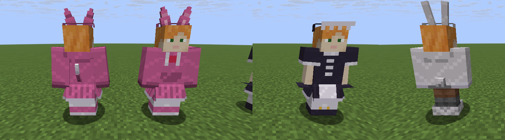

# FemboyEquipment 🎀

A cute little [Fabric](https://fabricmc.net/) mod for **Minecraft 1.21.11**.

## Download

Grab the latest jar from the [Releases page](../../releases/latest) and drop it into your `mods`
folder together with [Fabric API](https://modrinth.com/mod/fabric-api).

## Features

### Cat outfit 🐱

| Piece | Slot | Effect while worn |
|---|---|---|
| **Cat Ears** | Head | Night Vision |
| **Femboy Hoodie** | Chest | Regeneration I |
| **Pleated Skirt** | Legs | Speed I |
| **Thigh Highs** ✨ | Feet | Absolutely broken: Speed III, Haste III, Strength III, Resistance III, Jump Boost II, Regeneration II, Fire Resistance, Water Breathing, Dolphin's Grace, Saturation, no fall damage, slow falling while sneaking mid-air. Unbreakable, fire-proof, 8 armor, 6 toughness. |

Wear all four for a set bonus: **Luck II** + **Hero of the Village** (cheap villager trades~).

### Maid outfit 🖤

| Piece | Slot | Effect while worn |
|---|---|---|
| **Maid Headband** | Head | Haste I |
| **Maid Dress** | Chest | Resistance I |
| **Maid Apron** | Legs | Fire Resistance |
| **Mary Janes** | Feet | Speed I |

Full set bonus: **Haste II** + **Strength I**.

### Bunny outfit 🐰

| Piece | Slot | Effect while worn |
|---|---|---|
| **Bunny Ears** | Head | Jump Boost I |
| **Bunny Hoodie** | Chest | Regeneration I |
| **Fluffy Slippers** | Feet | Jump Boost II, no fall damage |

Full set bonus (all three): **Speed II** + **Jump Boost III**.

### 3D accessories & dyeing

- Cat Ears and Bunny Ears render as real 3D ears, and come with a swishing cat tail / fluffy bunny tail
- The Pleated Skirt and Maid Apron render as flared 3D skirts
- **Every outfit piece is dyeable** like leather armor. Craft it with any dye to recolor it (ears and tails included).

### Accessories (hold in your offhand)

- **Programming Socks** – Haste II
- **Hair Clip** – Luck
- **Choker** – Strength I
- **Pink Ribbon** – crafting material

### Other goodies

- **Strawberry Milk** – drink it for Speed II (30s) + Regeneration (10s)
- **Sparkly Sword** & **Sparkly Pickaxe** – diamond-tier, more durable, very enchantable
- **Pastel Pink Bricks** & **Block of Ribbons** – decoration
- A **Femboy Equipment** creative tab holding everything

## Crafting

| Item | Recipe |
|---|---|
| Pink Ribbon ×2 | 2 String + Pink Dye (shapeless) |
| Programming Socks | White Wool / Pink Wool stripes: `W W` · `P P` · `W W` |
| Hair Clip ×2 | Pink Ribbon + Iron Ingot (shapeless) |
| Choker | `SSS` · `S S` · ` D ` (String, Pink Dye) |
| Strawberry Milk ×3 | Milk Bucket + Sweet Berries + Sugar + 3 Glass Bottles (shapeless) |
| Cat Ears | `P P` · `RHR` (Pink Wool, Ribbon, Hair Clip) |
| Femboy Hoodie | `P P` · `PCP` · `PPP` (Pink Wool, Choker) |
| Pleated Skirt | `PRP` · `P P` · `P P` (Pink Wool, Ribbon) |
| Thigh Highs | `RNR` · `S S` (Ribbon, Netherite Ingot, Programming Socks) |
| Maid Headband | `WWW` · `S S` (White Wool, String) |
| Maid Dress | `B B` · `BWB` · `BBB` (Black Wool, White Wool) |
| Maid Apron | `BRB` · `W W` · `W W` (Black Wool, Ribbon, White Wool) |
| Mary Janes | `R R` · `L L` (Ribbon, Leather) |
| Bunny Ears | `H H` · `WRW` (Rabbit Hide, White Wool, Ribbon) |
| Bunny Hoodie | `W W` · `WFW` · `WWW` (White Wool, Rabbit's Foot) |
| Fluffy Slippers | `W W` · `H H` (White Wool, Rabbit Hide) |
| Sparkly Sword | `RDR` · ` D ` · ` S ` (Ribbon, Diamond, Stick) |
| Sparkly Pickaxe | `DDD` · `RSR` · ` S ` (Diamond, Ribbon, Stick) |
| Pastel Pink Bricks ×8 | 8 Bricks around a Pink Dye |
| Block of Ribbons | 9 Pink Ribbons (and back) |

All outfits and the sparkly tools are repaired with Pink Wool or Pink Ribbons.

## Requirements

| Thing | Version |
|---|---|
| Minecraft | 1.21.11 |
| Fabric Loader | ≥ 0.18.4 |
| Fabric API | 0.141.6+1.21.11 |
| Java (to play) | 21+ |
| Java (to build) | 25+ (needed by Fabric Loom 1.19) |

## Building

    ./gradlew build

The mod jar ends up in `build/libs/`. Drop it (plus Fabric API) into your `mods` folder.

## Running in dev

    ./gradlew runClient

## License

MIT
